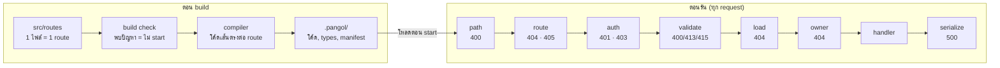
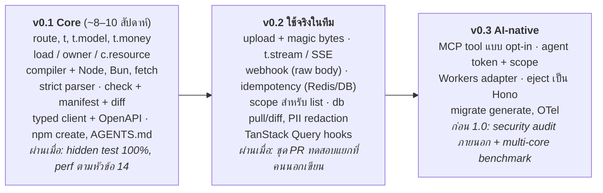

# pangol — Technical Specification v0.1

Oct 14, 2026 · @Sawanghos

## 1. ภาพรวม

pangol คือ backend framework บน TypeScript ที่ทำให้ทีมกล้าปล่อยให้ AI เขียน API ขึ้น production: ช่องโหว่พื้นฐานกลายเป็น build error และทุกการเปลี่ยนแปลงที่เสี่ยงถูกยกขึ้นมาให้เห็นใน PR, เสียบเข้าโปรเจกต์เดิมได้ และถอดออกได้เสมอ (`pangol` บน npm · GitHub org: pangoljs)

**กลุ่มเป้าหมาย:** ทีม TypeScript ที่ใช้ AI coding tools เขียน backend และต้อง review โค้ดก่อน merge; ทีมที่ใช้ Express/Fastify/Hono อยู่และอยากย้ายทีละส่วน

**เป้าหมายของ v0.1**

1. ทุก route ต้องประกาศ auth, schema ขาเข้า-ขาออก และ owner ชัดเจน มิฉะนั้น build ไม่ผ่าน
2. Response ถูกกรองตาม schema เสมอ field ที่ไม่ได้ประกาศไม่มีทางออกไปถึง client
3. `pangol diff` สรุปการเปลี่ยนแปลงด้านความปลอดภัยของ PR ให้อ่านจบในไม่กี่วินาที
4. ความเร็วไม่ต่ำกว่า Hono และ Elysia บนรันไทม์เดียวกัน และ IDE ยังเร็วที่ 2,000 route
5. AI ที่ไม่เคยเห็นเฟรมเวิร์กเขียนถูกจากเอกสารหน้าเดียว

**ไม่ใช่เป้าหมาย**

- ไม่ใช่ full-stack framework ไม่มี UI, ORM หรือ job queue ของตัวเอง
- ไม่สัญญาว่า "ไม่มีช่องโหว่" ตรรกะธุรกิจใน handler ยังต้องอาศัยเทสต์และคน review
- ไม่ผูกกับรันไทม์เดียว แต่ v0.1 รองรับเฉพาะ Node และ Bun
- ไม่แข่งกับ Go ในงาน CPU หนัก

## 2. หลักฐานจาก PoC

แนวคิดหลักทุกข้อผ่าน PoC แล้ว แต่ตัวเลขทั้งหมดมาจากเครื่อง 2 vCPU เครื่องเดียว และชุดทดสอบส่วนใหญ่เขียนโดยผู้ออกแบบเอง

| PoC | คำถาม | ผลที่วัดได้ | ข้อจำกัด |
| --- | --- | --- | --- |
| 1 Typed RPC | IDE ยังเร็วเมื่อมีหลายพัน route ไหม | 2,000 route: autocomplete 0.3–0.5 s (Hono 48–50 s), `tsc` client 0.77 s (Hono 47 s) | ยังไม่ได้เทียบกับวิธีแยก route ของ Hono; codegen ใช้ 5.3 s |
| 2 Runtime | compile ตอน build เร็วแค่ไหน | 1 core บน Bun: GET 44k req/s (Hono 22k, Elysia 41k, Go net/http 28k); RAM 35 MB | 1 core ต่อ server เท่านั้น, ไม่มี DB |
| 3 Strict parser | กัน CVE จริงได้ไหม | regression 13/13 (Hono, Fastify, Elysia), fuzz \~24 ล้าน input; Node ช้าลงไม่เกิน noise, Bun −5% | JSON ใหญ่ช้ากว่า `JSON.parse` \~2 เท่า |
| 4 AI | AI เขียนถูกและปลอดภัยกว่า Hono ไหม | 3 รุ่นผ่าน hidden test 100% จากเอกสารหน้าเดียว; โค้ดสั้นกว่า 1.4–3.3 เท่า | **ความปลอดภัยต่างจาก Hono น้อยมาก** (61/61 vs 60/61); โจทย์เล็ก |
| 5 Review | manifest diff ยกช่องโหว่ใน PR ได้ไหม | หลังแก้กฎ: 24/26 PR ที่มีช่องโหว่ถูก block หรือยกขึ้นมา, 🔴 เตือนผิด 0/10 | **กฎก่อนแก้จับชุดทดสอบแยกได้แค่ 1/7**; ยังไม่มีชุดแยกชุดใหม่ |

ผลต่อการออกแบบ: จุดขายไม่ใช่ "AI เขียนแล้วปลอดภัยกว่า" แต่คือความปลอดภัยถูกบังคับในโครงสร้าง และมองเห็นได้ตอน review

## 3. สถาปัตยกรรม

งานหนักทั้งหมดทำตอน build: compiler อ่าน `src/routes` ตรวจกฎ แล้ว generate ฟังก์ชันเส้นตรงหนึ่งตัวต่อ route ตอนรันจริงไม่มี middleware chain และไม่ต้องโหลดไลบรารี schema

**สามชั้น**

- **Core (runtime-neutral):** compiler, กฎ build check, schema และ strict parser ใช้แค่ Web Standards (Web Crypto, Streams, URL) ไม่เรียก API เฉพาะรันไทม์
- **Adapters:** generate โค้ดที่ใช้ทางที่เร็วที่สุดของแต่ละรันไทม์
  - Bun: `Bun.serve` + native `routes`, ตรวจค่า param ทุกตัวด้วย `safeSegment` (router ของ Bun decode param ให้แล้ว)
  - Node: `node:http` ตรง ไม่สร้าง `Request` object, dispatcher ที่ generate ไว้, ตรวจ request-target ดิบ; header ที่ส่งซ้ำ (เช่น `Authorization` สองบรรทัด) ถูกรวมแบบ fetch จึงกลายเป็นค่าที่ผิดรูปแบบ ไม่ใช่ใช้ตัวแรก; body ที่ไม่ได้อ่านจนจบ → ตอบพร้อม `Connection: close`
  - Fetch: `fetch(request)` มาตรฐาน สำหรับเสียบเข้า Next.js/Hono และรันไทม์อื่นในอนาคต
  - ข้อจำกัดของ Fetch และ Bun: รันไทม์ normalize URL ก่อนถึงแอป — ตัด dot-segment ทั้งแบบตรงและแบบ encode (`/a/%2E%2E/b` มาถึงเป็น `/b`) และ Bun ยุบ `//` ที่ต้น path ด้วย แอปจึงเสิร์ฟ path ที่ normalize แล้ว (ไม่ใช่ path อื่น) แทนการตอบ 400; รูปแบบอื่นในหัวข้อ 8 ยังถูกปฏิเสธ ส่วน Node adapter อ่าน request-target ดิบจึงปฏิเสธได้ครบ conformance test บันทึกความต่างนี้ไว้ทีละกรณี
- **Tooling:** CLI (`check`, `diff`, `dev`, `build`), codegen ของ typed client และ OpenAPI

**ลำดับต่อ request (คงที่ ทุก adapter ต้องตรงกัน)**

1. ตรวจ request-target (path) แบบเข้มงวด → 400
2. Match route → 404 / 405
3. Auth → 401 / 403
4. Rate limit → 429
5. Validate params, query, body (รวม Content-Type, ขนาด, ความลึก JSON) → 400 / 413 / 415
6. `load` → 404 เมื่อไม่พบ
7. `owner` → 404 เมื่อไม่ใช่เจ้าของ
8. Handler
9. กรองและ serialize ตาม `response` ด้วย serializer ที่ compile ไว้ → 500 ถ้าค่าไม่ตรง schema

Route ที่ไม่อ่าน body ต้องเป็นฟังก์ชัน sync สร้าง Promise เฉพาะเมื่อ handler เป็น async (PoC 2: เร็วขึ้น 30%)


ตัวเลขใต้ชื่อขั้น = status ที่ตอบเมื่อขั้นนั้นปฏิเสธ · serialize ตัด field ที่ไม่ได้ประกาศทิ้ง

ทุกขั้นก่อน handler ปฏิเสธ request ได้เอง handler จึงเห็นเฉพาะ input ที่ผ่าน auth, validate และ owner แล้ว

## 4. โครงสร้างโปรเจกต์และ routing

หนึ่งไฟล์คือหนึ่ง route ชื่อไฟล์บอก method และ path ทั้งหมด เพื่อให้คนและ AI เข้าใจ route ได้จากไฟล์เดียว

```
my-api/
├─ src/
│  ├─ routes/
│  │  ├─ health.get.ts          # GET  /health
│  │  └─ posts/
│  │     ├─ index.get.ts        # GET  /posts
│  │     ├─ index.post.ts       # POST /posts
│  │     ├─ [id].patch.ts       # PATCH /posts/:id
│  │     └─ _guards.ts          # ไม่ใช่ route (ขึ้นต้นด้วย _)
│  ├─ models.ts                 # t.model ที่ใช้ร่วมกัน
│  ├─ auth.ts                   # defineAuth
│  └─ services.ts               # defineServices (onStart / onShutdown)
├─ pangol.config.ts
├─ AGENTS.md
└─ .pangol/                       # ผล build: โค้ดที่ generate, api.d.ts, manifest (gitignore)
```

**กฎการตั้งชื่อ**

- `<name>.<method>.ts` โดย method คือ `get`, `post`, `put`, `patch`, `delete`
- `index` แทนพาธของโฟลเดอร์, `[id]` คือ path param
- ไฟล์ที่ขึ้นต้นด้วย `_` ไม่ใช่ route; ไฟล์อื่นใน `routes/` ที่ชื่อผิดรูปแบบ = build error
- Segment ตายตัวชนะ param (`posts/search.get.ts` ก่อน `posts/[id].get.ts`); method + path ซ้ำ = build error
- ไม่มี `_config` ระดับโฟลเดอร์ การตั้งค่าที่ใช้ร่วมกันทำด้วย helper ธรรมดาที่คืน `route({...})` (เช่น `webhook({...})`)

**`pangol.config.ts`**

```ts
export default defineConfig({
  runtime: 'bun',                  // 'bun' | 'node' | 'fetch'; v0.1 เริ่มจาก Bun
  basePath: '/api/v2',             // ตอนเสียบเข้าระบบเดิม
  cors: { origins: ['https://app.example.com'] },
  limits: { body: '1mb', timeout: '10s', jsonDepth: 32, jsonKeys: 256, multipartParts: 100 },
  strict: { trailingSlash: 'reject' },
})
```

## 5. Route API

Route คือ object เดียวที่ประกาศทุกอย่างที่เกี่ยวกับความปลอดภัย และ handler ได้ context `c` ที่มี type ครบจาก schema โดยอัตโนมัติ

```ts
import { route, t } from 'pangol'
import { Post } from '../../models'

export default route({
  auth: 'user',
  params: t.object({ id: t.id() }),
  load: (c) => db.posts.get(c.params.id),
  owner: (c, post) => post.authorId === c.user.id,
  body: Post.pick('title', 'body').partial(),
  response: Post.public(),
  handler: (c) => db.posts.update(c.resource.id, c.body),
})
```

**Options**

| option | จำเป็น | ความหมาย |
| --- | --- | --- |
| `auth` | เสมอ | ใครเรียกได้ (ตารางถัดไป) |
| `response` | เสมอ | schema ของสิ่งที่ส่งออก; field นอก schema ถูกตัดทิ้ง; `t.empty()` คู่กับ `c.noContent()`; ตัว response เองเป็น `.optional()` ไม่ได้ (type error) |
| `handler` | เสมอ | `(c) => value` หรือ async |
| `params` | ไม่บังคับ | ไม่ประกาศ = string 1–200 ตัวที่ผ่าน `safeSegment`; ประกาศแล้วต้องเป็น `t.object` และชื่อต้องตรงกับชื่อไฟล์ |
| `query` | เมื่อ handler อ่าน `c.query` | `t.object`; key ซ้ำ = 400; แปลงเป็นตัวเลข/boolean ตาม schema |
| `body` | เมื่อ handler อ่าน `c.body` | POST/PUT/PATCH เท่านั้น; `t.object` (JSON) หรือ `t.multipart` |
| `load` | เมื่อมี owner function | ดึง record ก่อน handler (หัวข้อ 7) |
| `owner` | เมื่อมี path param และไม่ใช่ public | function, `'none'` หรือ `'query'` |
| `rateLimit` | ไม่บังคับ | `'10/min'` ต่อ IP + user; store ในหน่วยความจำ (v0.1) |
| `description` | ไม่บังคับ | ใช้ใน OpenAPI |

ชื่อ option ที่ไม่รู้จัก = build error พร้อม "did you mean"

**`auth`**

| ค่า | ใครเรียกได้ | `c.user` |
| --- | --- | --- |
| `'public'` | ทุกคน header Authorization ถูกเมิน | `null` เสมอ (อ่าน `c.user` = build error) |
| `'optional'` | ทุกคน; ส่ง credential มา (header `Authorization` หรือ cookie ที่ `from` ระบุ) ต้องถูก มิฉะนั้น 401 | user หรือ `null` |
| `'user'` | คนที่ login (มิฉะนั้น 401) | user |
| `{ permission: 'x' }` | user ที่มี permission (มิฉะนั้น 403); ชื่อว่างไม่ได้ | user |

**Context `c`:** `c.params`, `c.query`, `c.body` (validate แล้ว มีเฉพาะ field ที่ประกาศ), `c.user`, `c.resource`, `c.ip`, `c.headers` (read-only)

**ผลลัพธ์ของ handler:** คืน value = 200 · `c.created(v)` = 201 · `c.noContent()` = 204 · `c.fail(status, message)` = status พร้อม `{ error }` (4xx ที่ลงทะเบียนเท่านั้น: 2xx จะข้ามการกรอง response และ 5xx ต้องมาจาก throw) · throw = 500 (รายละเอียดอยู่ใน log เท่านั้น)

**Type:** `route()` ต้อง infer type ของ `c.params`, `c.query`, `c.body`, `c.resource` (จากค่าที่ `load` คืน) และ `c.user` (จาก `defineAuth`, เป็น `null` ได้เมื่อ `'optional'`) และตรวจว่าค่าที่ handler คืนตรงกับ `response` โดยไม่ instantiate type ของทั้งแอป

## 6. Schema

ประกาศแต่ละ entity ครั้งเดียวด้วย `t.model` แล้ว route ดึงไปใช้เฉพาะส่วนที่ต้องการ บน schema ทุกตัว compiler สร้าง validator และ serializer ตอน build

**Primitive**

| schema | options | หมายเหตุ |
| --- | --- | --- |
| `t.string()` | `min`, `max` (ค่าเริ่มต้น 10,000), `pattern` | ตรวจความยาวก่อน regex เสมอ (กัน ReDoS) |
| `t.email()` | `max` (254) |  |
| `t.id()` |  | string 1–200 ผ่าน `safeSegment` |
| `t.uuid()` |  |  |
| `t.int()` / `t.number()` | `min`, `max` | query/params แปลงจาก string; body ไม่แปลง |
| `t.money()` | `currency`, `scale` (ค่าเริ่มต้น 2) | v0.1 · รับ/ส่งเป็น decimal string, ภายในเป็นหน่วยย่อยแบบจำนวนเต็ม (bigint) ห้าม float; คำนวณผ่าน helper ที่ปัดเศษแบบระบุชัด |
| `t.bool()` |  |  |
| `t.enum([...])` |  |  |
| `t.array(item)` | `min`, `max` (1,000) |  |
| `t.object({...})` |  | ตัด key ที่ไม่ได้ประกาศทิ้งเสมอ |
| `t.empty()` |  | response ของ 204 |
| `t.multipart({...})` + `t.file()` | `maxSize`, `types` | หัวข้อ 8 |
| `t.pagination()` |  | `page`, `limit` พร้อมขอบเขต |

Modifier: `.optional()`, `.default(v)`, `.private()`

**Model**

```ts
// src/models.ts
export const User = t.model({
  id: t.id(),
  name: t.string({ min: 1, max: 100 }),
  email: t.email(),
  role: t.enum(['admin', 'member']),
  passwordHash: t.string().private(),
})

User.public()                     // ทุก field ที่ไม่ private
User.pick('name', 'email')        // สำหรับ body ตอนสร้าง
User.pick('name').partial()       // สำหรับ PATCH
User.omit('role')
```

- Field ที่เป็น `.private()` ห้ามอยู่ใน `response` (pick ตรงๆ = build error) และถูกปิดใน log อัตโนมัติ (v0.2)
- `pangol db pull --from postgres|mysql|sqlite|prisma|drizzle` สร้าง `models.gen.ts` และตั้งชื่อคอลัมน์ `password*`, `*token*`, `*secret*`, `*hash*` เป็น private ให้อัตโนมัติ (v0.2)

**แหล่งความจริงของ model (ล็อกไว้ตั้งแต่ v0.1)**

- แต่ละตารางมีแหล่งความจริงแหล่งเดียว: `models: { source: 'database' | 'framework' }` ใน `pangol.config.ts` (ตั้งต่อตารางได้) ห้ามแก้ทั้งสองฝั่ง
- `'database'` (v0.2): `pangol db pull` อ่าน Postgres/MySQL/SQLite หรือ Prisma/Drizzle สร้าง `models.gen.ts` (ห้ามแก้มือ) ส่วน `models.ts` ของผู้ใช้ใช้ pick/omit/เติม `.private()`; `numeric` → `t.money`, `bigint` → string; `db diff` ใน CI จับ schema ที่เลื่อนจาก DB
- `'framework'` (v0.3): `pangol migrate generate` สร้างไฟล์ SQL up/down ให้คน review, ทำเครื่องหมายการเปลี่ยนที่ทำลายข้อมูล และถามเมื่อแยกไม่ออกว่า rename หรือ drop+add; ตัวสร้าง SQL ส่งต่อให้ Drizzle Kit หรือ Atlas ไม่เขียนเอง
- ผลต่อ v0.1: `t.model` ต้องเก็บ metadata ของ DB เพิ่มได้ (ชื่อคอลัมน์จริง, foreign key, index, default) โดยไม่เปลี่ยน API ที่ route ใช้

**Standard Schema (Zod, Valibot, ArkType)**

- ใช้ใน `params`, `query`, `body`, `response` ได้ โดยแปลงเป็น JSON Schema ตอน build แล้ว compile เป็น validator และ serializer ของเราเอง
- ไลบรารีที่แปลงไม่ได้ หรือ response schema ที่ยอมรับ key เกิน (`additionalProperties`, `looseObject`, ArkType ที่ไม่ได้ตั้ง `onUndeclaredKey: 'delete'`) = build error
- ไม่มีการเรียก `validate()` ของไลบรารีตอนรัน

## 7. Ownership: `load` และ `owner`

Route ที่มี path param และไม่ใช่ `'public'` ต้องประกาศ `owner` เสมอ เพื่อดึงกฎ IDOR ออกจาก handler มาอยู่ในส่วนที่ check และ manifest มองเห็น

| `owner` | ความหมาย | ใน manifest diff |
| --- | --- | --- |
| `(c, record) => boolean` | ผู้เรียกทำกับ record นี้ได้ ต้องมี `load` | แสดง source; เปลี่ยน = 🟡; ไม่อ้าง `c.user` = 🔴 |
| `'none'` | ทุกคนที่ผ่าน `auth` ทำกับทุก record ได้ | 🔴 เมื่อ auth เป็น user/optional, 🟡 เมื่อเป็น permission |
| `'query'` | handler บังคับเองใน query (เช่น `WHERE id = $1 AND user_id = $2`) | 🟡 เสมอ (ตรวจไม่ได้) |

**การทำงาน:** หลัง validate เรียก `load(c)` → ไม่พบ = 404 → `owner(c, record)` เป็น false = **404** (ไม่ใช่ 403 เพื่อไม่บอกว่า id นั้นมีอยู่จริง) → handler ได้ `c.resource`

**กฎ build check ที่เกี่ยวข้อง**

- มี `load` แต่ handler ไม่ใช้ `c.resource` = error (กัน load ตัวหนึ่ง แต่แก้อีกตัวจาก `c.params`)
- `owner: 'none'` แต่ handler ตอบ 403 เอง = error (กฎเจ้าของต้องอยู่ใน `owner`)
- owner function บน route public = error

**สิ่งที่ `owner` ไม่ครอบคลุม**

- id ที่มาใน body หรือ query (เช่น `toAccountId`) → diff ติดธง 🟡/🔴 ตามชื่อ field แต่ไม่บังคับ
- การกรองแถวใน list endpoint → v0.2 เพิ่ม `scope: (c) => (row) => boolean` ที่ประกาศแบบเดียวกับ owner
- race condition ระหว่าง `owner` กับ handler → งานสำคัญใช้ `owner: 'query'` หรือ transaction

## 8. การจัดการ request และค่าเริ่มต้นด้านความปลอดภัย

ทุก parser ปฏิเสธ input ที่กำกวมแทนการ normalize ทำงานแบบ linear time และมีลิมิตทุกมิติ (นำมาจาก PoC 3 พร้อม regression และ fuzz test)

| ส่วน | กฎ | ปิดช่องโหว่ประเภท |
| --- | --- | --- |
| Path | ผ่านเมื่อตรงกับที่ URL parser มาตรฐานเห็นทุกตัวอักษร; ปฏิเสธ `//`, `.`, `..`, `%2F`, `%2E`, `%5C`, NUL, hex พิมพ์เล็ก, อักขระที่ encode โดยไม่จำเป็น, UTF-8 ผิด, trailing slash, fragment; absolute-form รับเฉพาะ http(s) ที่ host ถูกต้อง | Hono CVE-2025-58362 |
| Param (Bun) | ค่าที่ decode แล้วห้ามมี `/`, `\`, `.`, `..`, control byte | พบใน Bun 1.4.2 |
| Content-Type | parse ครั้งเดียวใช้ตัดสินทุกอย่าง; JSON รับเฉพาะ `application/json` (charset utf-8); อื่น = 415 | Fastify CVE-2025-32442, CSRF ผ่าน `text/plain` |
| JSON | ลึก ≤ 32, key ≤ 256 ต่อ object, item ≤ 10,000, key ซ้ำ = 400, `__proto__`/`constructor`/`prototype` = 400 | prototype pollution, parser differential, DoS |
| Multipart | parse รอบเดียวด้วย Map, ≤ 100 parts, header ≤ 1 KB, field ≤ 64 KB; header ของ part (รวมชื่อไฟล์) อ่านเป็น UTF-8 | Elysia CVE-2026-56669 |
| UTF-8 | body ที่เป็นข้อความ (JSON, field ของ multipart) decode แบบ fatal: ไบต์ที่ไม่ใช่ UTF-8 = 400 ไม่แทนด้วย U+FFFD; BOM ไม่ถูกตัดทิ้ง จึงเป็น JSON ผิด = 400 | parser differential |
| Body | ≤ 1 MB (ปรับได้), ตัดทันทีเมื่อเกิน | DoS |
| Query | key ซ้ำ = 400 | parameter pollution |

**Response และ header**

- `content-type`, `x-content-type-options: nosniff`, `x-frame-options: DENY`, `cache-control: no-store` ทุก response
- Error เป็น `{ error, field? }` ไม่มี stack trace; 500 log รายละเอียดฝั่ง server เท่านั้น
- CORS ปิดเป็นค่าเริ่มต้น เปิดด้วย origin ที่ระบุเท่านั้น
- Node: `requestTimeout` 10 s, `headersTimeout` 5 s

**Upload (v0.2)**

- อ่านแบบ stream ตัดทันทีเมื่อเกิน `maxSize`
- ตรวจชนิดไฟล์จาก magic bytes ด้วย peekable stream: อ่านวนจนครบ N ไบต์ แล้วส่งไบต์ที่พักไว้ออกก่อนส่วนที่เหลือ ไม่ใช้ `tee()`
- SVG และชนิดที่ไม่มี magic bytes ต้องระบุอนุญาตชัดเจน; ชื่อไฟล์จาก client เก็บเป็นข้อมูลเท่านั้น ไม่ใช้เป็น path
- เอกสารแนะนำให้เสิร์ฟไฟล์ที่อัปโหลดจากคนละ domain และ abort multipart upload ของ S3 เมื่อล้มกลางทาง

## 9. Build check

`pangol check` รันก่อน `dev`, `build` และ `serve` ทุกครั้ง ถ้ามีปัญหาจะไม่ start เลย ทุก error บอกไฟล์, สิ่งที่ผิด และวิธีแก้ที่ AI ทำตามได้ทันที

```
✖ src/routes/posts/[id].delete.ts
  DELETE /posts/:id acts on a specific record (:id) but has no `owner` rule.
    Fix: add load: (c) => db.posts.get(c.params.id) and owner: (c, post) => post.authorId === c.user.id;
         or owner: 'none' if every caller allowed by auth may access every record
```

| # | กฎ | ผล |
| --- | --- | --- |
| C1 | ทุก route ต้องมี `auth` ที่ถูกต้อง | error |
| C2 | ทุก route ต้องมี `response` | error |
| C3 | handler อ่าน `c.body` / `c.query` ต้องมี schema ที่คู่กัน | error |
| C4 | `params` ต้องตรงกับ segment ในชื่อไฟล์ | error |
| C5 | GET/DELETE มี `body` ไม่ได้ | error |
| C6 | route ที่มี path param และไม่ใช่ public ต้องมี `owner`; owner function ต้องมี `load` | error |
| C7 | มี `load` แต่ handler ไม่ใช้ `c.resource` | error |
| C8 | `owner: 'none'` แต่ handler ตอบ 403 เอง | error |
| C9 | `auth: 'public'` แต่ handler อ่าน `c.user` | error แนะนำ `'optional'` |
| C10 | field `.private()` อยู่ใน `response` | error |
| C11 | response schema ยอมรับ key เกิน | error |
| C12 | option สะกดผิด / ไม่รู้จัก | error พร้อม did-you-mean |
| C13 | `t.empty()` แต่ไม่เรียก `c.noContent()` | error |
| C14 | ชื่อไฟล์ผิดรูปแบบ, route ซ้ำ, ไม่มี `auth.ts` ทั้งที่มี route ที่ไม่ใช่ public | error |
| C15 | `runtime: 'workers'` แต่ import ไลบรารีที่ใช้บน edge ไม่ได้ หรือมี `onShutdown` | warning (เมื่อมี Workers adapter) |

**ข้อจำกัด:** C3, C7, C8, C9 ตรวจจาก source ของ handler แบบ heuristic ใน PoC ใน v0.1 ต้องย้ายไปใช้ AST ของ TypeScript เพื่อไม่ให้หลบได้ด้วยการตั้งชื่อตัวแปรอื่น

ผลเมื่อผ่าน: ตารางทุก route พร้อม auth และ owner ที่มีผลจริง รวมค่าที่มาจาก helper

## 10. Security manifest และ diff

Manifest สรุปทุกสิ่งที่แต่ละ route เปิดให้ภายนอก สร้างจาก route object ที่โหลดจริง และ `diff` เทียบสอง manifest แล้วจัดกลุ่มตามความเสี่ยงสำหรับ comment ใน PR

**เนื้อหาต่อ route:** `file`, `auth`, `owner` (kind + source + hash + hash ของไฟล์ helper ที่ใช้), `load` (source + hash), `params`, `query`, `body`, `response` (เป็น field path เช่น `items[].id`), `responseIsList`, `usesUser`, `rateLimit`, `handler` (hash) · ระดับแอป: hash ของ `auth.ts` และไฟล์ที่ import

**กฎของ diff**

| ระดับ | เงื่อนไข |
| --- | --- |
| 🔴 ต้อง review | auth อ่อนลง; route กลายเป็น public (ยกเว้น GET ที่ไม่มี param = 🟡); owner กลายเป็น `'none'` หรือหาย; owner ไม่อ้าง `c.user`; response มี field ชื่อดูเป็นความลับ; body/query รับ field เจ้าของ (`userId`, `ownerId`…), สิทธิ์ (`role`, `isAdmin`…) หรือเงิน (`price`, `total`…); handler เลิกอ้าง `c.user`; `auth.ts` เปลี่ยน |
| 🟡 ต้องดู | owner หรือ helper ของ owner เปลี่ยน (แสดง source ก่อน/หลัง); load เปลี่ยน; `owner: 'query'`; field ใหม่ใน response; body/query รับ id ของ record อื่น; list ที่ handler เปลี่ยน; rate limit หาย |
| ✓ ครบตามกฎ | route ใหม่ที่ไม่ติดกฎด้านบน (แสดง auth, source ของ owner/load, field ที่ส่งออก) |
| ℹ ข้อมูล | handler เปลี่ยน (ตรรกะธุรกิจอยู่นอกขอบเขต), auth เข้มขึ้น, field หายจาก response, route ถูกลบ |

**CI**

- CI ต้องสร้าง manifest ใหม่ทั้ง base และ head ทุกครั้ง ห้ามเชื่อไฟล์ manifest ที่ commit มา (คนแก้ route แก้ manifest ได้ด้วย)
- GitHub Action ทางการ: `pangol diff origin/main..HEAD --format markdown` แล้วโพสต์เป็น comment เดียวที่อัปเดตทุก push
- `--fail-on high` ใช้เป็น required check ได้ พร้อมทางยกเว้นด้วย label `security-reviewed`

**ข้อจำกัดที่ต้องบอกผู้ใช้:** กฎหลายข้ออิงชื่อ field และ heuristic เลี่ยงได้ด้วยการตั้งชื่อหลบ; 🟡 แปลว่า "ไปดูโค้ด" ไม่ใช่คำตัดสิน; ตรรกะธุรกิจใน handler ได้แค่ ℹ

## 11. Typed client และ OpenAPI

Client ได้ type จากไฟล์ `.pangol/api.d.ts` ที่ generate ตอน build เป็น interface แบนต่อ method และ path ไม่ infer จากโค้ด server (PoC 1)

```ts
import { createClient } from 'pangol/client'
import type { Api } from 'my-api/.pangol/api'

const api = createClient<Api>({
  baseUrl: '/api/v2',
  headers: async () => ({ authorization: `Bearer ${await getToken()}` }),
})

const post = await api.get('/posts/:id', { params: { id } })
await api.patch('/posts/:id', { params: { id }, body: { title: 'New' } })
```

- ไม่ใช้ Proxy; path เป็น string ตรงกับเอกสาร API
- ตอบ non-2xx โยน `ApiError(status, body)`
- มี `fetch` ให้สลับได้ (สำหรับเทสต์, SSR) และ hook สำหรับ TanStack Query ใน v0.2
- โหมด dev: codegen แบบ incremental สร้าง type ใหม่เฉพาะไฟล์ที่แก้ (PoC ใช้ 5.3 s ต่อการ build ทั้งโปรเจกต์ 2,000 route)
- เป้าหมาย: autocomplete ≤ 500 ms ที่ 2,000 route

**OpenAPI 3.1:** `pangol openapi > openapi.json` สร้างจาก JSON Schema ชุดเดียวกับ client รวม security requirement ตาม `auth` และ `description` ของ route บน OpenAPI นี้ใช้เครื่องมือที่มีอยู่แล้วได้ เช่น mock server, SDK ภาษาอื่น และตรวจ breaking change

## 12. เสียบเข้าระบบเดิม และถอดออก

ตั้งแต่ v0.1 pangol ต้องเสียบเข้าเป็นโฟลเดอร์ย่อยของแอปเดิมได้ และใช้ ORM, schema และ session เดิมได้ทั้งหมด

| เป้าหมาย | วิธี | จุดที่ต้องระวัง |
| --- | --- | --- |
| Next.js | `app/api/v2/[...path]/route.ts` export GET/POST/… = `pangol.fetch` | ตั้ง `basePath` ให้ตรง |
| Hono | `app.mount('/api/v2', pangol.fetch)` |  |
| Express | `app.use('/api/v2', pangolExpress())` | ต้องเสียบ**ก่อน** `express.json()`; adapter ตรวจ `req._body === true` หรือ `req.readableEnded` แล้วโยน error พร้อมวิธีแก้; เสีย fast path ของ Node |

**Auth ของระบบเดิม:** `defineAuth({ from, resolve(req) })`
- `from: 'bearer'` (header `Authorization: Bearer <token>`) หรือ `from: { cookie: 'session' }` framework อ่าน credential เอง จึงรู้ว่า request มี credential หรือไม่ (ใช้กับ `'optional'`) และไม่เรียก `resolve` เลยเมื่อไม่มี
- `resolve(req)` ได้ `AuthRequest` แบบอ่านอย่างเดียว: `method`, `url`, `headers.get()`, `cookies.get()` และ `credential` ที่อ่านแล้ว adapter สร้างเองโดยไม่สร้าง `Request` (Node fast path) จึงเรียก `getSession()` ของ Auth.js, Lucia หรือ session เดิมได้ คืน `{ id, permissions }` หรือ `null` (sync หรือ async)
- **CSRF อัตโนมัติเมื่อ `from` เป็น cookie:** request ที่มี cookie credential และ method ไม่ใช่ GET/HEAD/OPTIONS ต้องผ่านกฎนี้ มิฉะนั้น 403 (แนวเดียวกับ `CrossOriginProtection` ของ Go)
  1. มี `Sec-Fetch-Site` → ผ่านเมื่อเป็น `same-origin` หรือ `none` หรือ `Origin` อยู่ใน `cors.origins`
  2. ไม่มี `Sec-Fetch-Site` แต่มี `Origin` → ผ่านเมื่อ host ของ `Origin` ตรงกับ `Host` ของ request หรืออยู่ใน `cors.origins`
  3. ไม่มีทั้งสอง → ผ่าน (ไม่ใช่ request จาก browser; browser ปัจจุบันส่งอย่างน้อยหนึ่งตัวกับ request ข้าม origin ที่เปลี่ยนข้อมูล)
  - เอกสารแนะนำให้ตั้ง cookie เป็น `SameSite=Lax` หรือ `Strict` ด้วย

**Services:** `defineServices({ onStart, onShutdown })` บน Node/Bun ดัก SIGTERM หยุดรับ connection ใหม่ ปิด keep-alive ที่ว่าง รอ request ที่ค้างไม่เกิน 25 s แล้วเรียก `onShutdown`; เมื่อเสียบเข้าแอปเดิม lifecycle เป็นของแอปเดิม

**Eject (v0.3):** `pangol eject --to hono` แปลงทุก route เป็นโค้ด Hono ธรรมดา พร้อม helper ที่คัดลอกออกมา (ตัวกรอง response, strict parser, ตัวตรวจ magic bytes) โค้ดที่มีอยู่ยังปลอดภัยเท่าเดิม แต่การป้องกันการแก้ไขในอนาคต (build check, owner, diff) จะหายไป เอกสารต้องบอกตรงๆ

## 13. CLI

| คำสั่ง | หน้าที่ | เวอร์ชัน |
| --- | --- | --- |
| `npm create pangol@latest <dir>` | สร้างโปรเจกต์พร้อม `auth.ts`, ตัวอย่าง route, เทสต์, `AGENTS.md` | 0.1 |
| `pangol dev` | check + server + codegen แบบ watch | 0.1 |
| `pangol check [--manifest out.json]` | build check; เขียน manifest | 0.1 |
| `pangol build [--runtime node\|bun\|fetch]` | generate โค้ดที่ compile แล้วลง `.pangol/` | 0.1 |
| `pangol serve [port]` | รัน build ที่ compile แล้ว | 0.1 |
| `pangol diff a.json b.json` | เทียบ manifest สองไฟล์ | 0.1 |
| `pangol diff main..HEAD` / `diff main` | เทียบ git ref หรือ ref กับ working tree | 0.1 |
| `diff` options | `--fail-on high\|check`, `--json out.json`, `--format markdown\|text` | 0.1 |
| `pangol openapi` | OpenAPI 3.1 ออก stdout | 0.1 |
| `pangol routes` | ตาราง route, auth, owner | 0.1 |
| `pangol db pull --from postgres\|mysql\|sqlite\|prisma\|drizzle` | สร้าง `models.gen.ts` | 0.2 |
| `pangol db diff` | เทียบ models.gen.ts กับ DB จริง ไม่ตรง = exit 1 (ใช้ใน CI) | 0.2 |
| `pangol migrate generate <name>` | สร้าง SQL up/down จาก model ที่ source = 'framework' ให้คน review | 0.3 |
| `pangol eject --to hono` | ถอดออก | 0.3 |

Exit code: 0 ผ่าน · 1 มีปัญหา / เกินเกณฑ์ `--fail-on` · 2 ใช้คำสั่งผิด

## 14. เป้าหมายประสิทธิภาพ

เป้าหมายตั้งจากผล PoC และต้องรักษาได้เมื่อเปิด strict mode เต็มที่ CI รัน benchmark ทุก release และ fail เมื่อช้าลงเกิน 10% จาก release ก่อน

| ตัววัด | เป้าหมาย v0.1 | ค่าอ้างอิงจาก PoC |
| --- | --- | --- |
| Overhead เทียบ server เปล่า (`/health`) | ≥ 90% ของ Bun.serve / node:http | 94% / 96% |
| GET พร้อม auth + owner + กรอง response, 1 core | ≥ Elysia (Bun), ≥ 1.3x Hono (Node) | 44k req/s Bun, 20k Node |
| POST พร้อม validate body, 1 core | ≥ Elysia (Bun) | 27.8k req/s Bun |
| p99 latency (GET, 64 connections) | ≤ Hono | 4.1 ms vs 5.9 ms |
| RAM หลังรับโหลด | ≤ Hono บนรันไทม์เดียวกัน | 35 MB vs 50 MB |
| Autocomplete ที่ 2,000 route | ≤ 500 ms | 0.3–0.53 s |
| `tsc` client ที่ 2,000 route | ≤ 2 s | 0.77 s |
| Strict parser overhead | ≤ 5% | Node \~0%, Bun −4 ถึง −5% |

**วิธีวัด:** wrk (`-t1 -c64`), server และ load generator pin คนละ core, A/B สลับรอบ 5 ครั้งใช้ค่ามัธยฐาน, ทุก server ต้องผ่าน conformance test ก่อนวัด · เพิ่มใน v0.1: ทดสอบ multi-core (Node cluster / Bun `reusePort`) เทียบ Go ที่ใช้ทุก core และ workload ที่มีฐานข้อมูลจริง

## 15. การทดสอบและคุณภาพ

ชุดทดสอบจาก PoC ทั้งหมดย้ายเข้า CI ตั้งแต่วันแรก และ release ใดที่ทำให้ชุดใดชุดหนึ่งตกออกไม่ได้

| ชุด | รันเมื่อ | เกณฑ์ |
| --- | --- | --- |
| Unit test ของ core, schema, compiler | ทุก PR | ผ่านทั้งหมด |
| CVE regression (Hono, Fastify, Elysia + กรณี Bun param) | ทุก PR | 100% |
| Fuzz (fast-check, กฎ 6 ข้อจาก PoC 3) | PR: 20k กรณี · ทุกคืน: 24 ล้าน | ไม่มี counterexample |
| Conformance (ทุก adapter ตอบเหมือนกัน) | ทุก PR | ทุกกรณีตรงกัน |
| Hidden test จาก PoC 4 (reference app) | ทุก PR | 100% |
| PR suite ของ diff (V/B/R จาก PoC 5) | ทุก PR | ไม่ต่ำกว่า baseline: หลุด ≤ 2/26, 🔴 เตือนผิด 0 |
| Mutation test ของ build check | ทุก PR | การลบ auth/schema/owner ถูกจับ 100% |
| Type performance (2,000 route) | ทุก release | ตามหัวข้อ 14 |
| Benchmark | ทุก release | ช้าลง ≤ 10% |
| AI pass rate (3 รุ่น, โจทย์จาก PoC 4–5) | ทุกครั้งที่แก้ API หรือเอกสาร | hidden test ≥ 95%, ไม่มี owner `'none'` + 403 |

**กฎการเพิ่มกฎ diff:** กฎใหม่ต้องมาพร้อม PR ทดสอบที่มีช่องโหว่และที่ปลอดภัย และต้องมีชุดทดสอบแยก (คนอื่นเขียน ไม่ใช้ปรับกฎ) ทุก release เพราะ PoC 5 แสดงว่ากฎที่ผ่านชุดของตัวเองจับชุดแยกได้แค่ 1/7

**Release:** semver, signed release + SBOM, ไม่มี runtime dependency ใน core, SECURITY.md พร้อมระยะเวลาตอบ, audit จากบุคคลที่สามก่อน 1.0

## 16. ความพร้อมสำหรับ AI

เอกสารคือส่วนหนึ่งของ API: PoC 5 พิสูจน์ว่าข้อความเก่าสองบรรทัดที่ขัดกันทำให้ Haiku เขียนกฎเจ้าของผิดที่ และหลังแก้เอกสารก็เขียนถูกทันที

- **เอกสารหลักหน้าเดียว** (ต่อยอดจาก `HYPERFLAT.md` ใน PoC) เผยแพร่เป็น `llms.txt` และ markdown ล้วน; ทุกตัวอย่างในเอกสารต้องผ่าน `pangol check` ใน CI กันตัวอย่างเก่าค้าง
- **`AGENTS.md`** ในทุกโปรเจกต์ที่สร้างด้วย `npm create`: กฎ 1 ไฟล์ 1 route, กฎเจ้าของอยู่ใน `owner`, รัน `npm run check` หลังแก้ทุกครั้ง
- **Error message** เขียนให้ AI ทำตามได้ทันที: บอกไฟล์, สิ่งที่ผิด และโค้ดที่ต้องใส่
- **ทำเรื่องเดียวด้วยวิธีเดียว** API นิ่ง ถ้าต้อง breaking ต้องมี codemod
- **MCP server ของเอกสาร** และการ expose route เป็น MCP tool แบบ opt-in อยู่ใน v0.3

## 17. Roadmap



v0.1 เริ่มจาก type inference ของ `route()` ก่อน เพราะเป็นส่วนเดียวของ core ที่ PoC ยังไม่ได้พิสูจน์ และสัมภาษณ์ผู้ใช้คู่ขนานไปใน 3 สัปดาห์แรก

**เพิ่มเติมจากรอบนี้:** `t.money` และกฎห้าม float กับเงินอยู่ใน v0.1 · `db pull` + `db diff` อยู่ใน v0.2 · `migrate generate` อยู่ใน v0.3 · หลัง v0.3 คือ **Financial profile** (idempotency key, audit log แบบ append-only ต่อ hash, step-up auth `recentMfa`, transaction/row lock, rate limit แบบกระจาย, เข้ารหัสระดับ field, mTLS, SBOM + signed release) โดยใช้คำว่า "financial-grade ready" ไม่ใช่ "ผ่านมาตรฐานการเงิน" เพราะการรับรองจริงขึ้นกับระบบทั้งหมดที่ผู้ใช้สร้าง

## 18. คำถามที่ยังเปิดและความเสี่ยง

| ความเสี่ยง | ผลถ้าเกิด | ทำอะไร |
| --- | --- | --- |
| ยังไม่ได้คุยกับผู้ใช้จริง | สร้างของที่ไม่มีคนต้องการ | สัมภาษณ์ 5–10 คนใน 3 สัปดาห์แรก คู่กับการสร้าง |
| TypeScript inference ของ handler (`c.resource` จาก `load`, `c.user` จาก `defineAuth`) | DX แย่หรือ IDE ช้าตอนเขียน server | ทำเป็นงานแรกของ v0.1 พร้อมวัด instantiations |
| กฎ diff ยังไม่มีชุดทดสอบแยกหลังแก้ | ตัวเลขที่อ้างใน pitch สูงเกินจริง | หาคนนอกเขียน PR ทดสอบชุดใหม่; ใช้ AST แทน regex |
| Multi-core เทียบ Go ยังไม่ได้วัด | อ้าง "ใกล้ Go" ไม่ได้ | เครื่องหลาย core + workload ที่มี DB |
| ความเสถียรของ Bun (memory leak, router ที่ decode param) | ปัญหาใน production ที่เราคุมไม่ได้ | เริ่ม Bun ก่อน; ตรวจ decoded param แบบเข้มงวด; conformance test ก่อนเพิ่ม Node/fetch adapter |
| กฎเข้มงวดปฏิเสธ request ที่ถูกต้องแต่ไม่เป็นมาตรฐาน | ใช้กับ client เก่าไม่ได้ | ตัวเลือกใน `strict` พร้อม log เหตุผลที่ปฏิเสธ |
| JSON pre-scan ช้ากว่า `JSON.parse` \~2 เท่าสำหรับ body ใหญ่ | เสียความเร็วกับ payload ใหญ่ | ระยะยาว: scanner แบบ native |
| พึ่งพาแค่ผลทดสอบกับ AI ตระกูลเดียว | AI ตัวอื่นอาจเขียนไม่ถูก | เพิ่ม GPT, Gemini และโมเดล open-source ในชุด AI pass rate |
| เงินถูกคำนวณด้วย float (PoC 4 ก็ทำแบบนั้น) | ยอดเงินคลาดเคลื่อน ใช้กับงานการเงินไม่ได้ | `t.money` ใน v0.1 + build check เตือนเมื่อ field ชื่อ price/amount/total/balance ใช้ `t.number` |

**คำถามที่ต้องตัดสินก่อนเริ่ม**

- ชื่อ: ตัดสินแล้วเป็น pangol (npm: pangol + @pangol, GitHub org: pangoljs, mascot: ตัวนิ่ม) — ยังต้องเช็คโดเมนและเครื่องหมายการค้า
- License: MIT (ค่าเริ่มต้นที่เสนอ)
- รันไทม์หลักของ v0.1: ตัดสินแล้ว เริ่ม Bun ก่อน โดย core ยังคง runtime-neutral; Node และ fetch adapter ตามมา
- การตอบ 404 เมื่อไม่ผ่าน owner ควรเปิดให้เปลี่ยนเป็น 403 ต่อ route ได้หรือไม่
- Idempotency อยู่ใน core หรือเป็น plugin: เสนอให้เป็น option `idempotent: true` ของ route() ตั้งแต่ v0.1 (สงวนชื่อไว้ก่อน ทำจริงทีหลังได้) เพื่อไม่ให้การเพิ่มภายหลังทำให้ API เดิมพัง ต้องตัดสินว่าเก็บ key ที่ไหน (memory/Redis/DB) และอายุของ key
- ~~`t.money` ส่งออกทาง JSON เป็น string หรือ integer~~ ตัดสินแล้ว: decimal string (`"12.50"`) ดู DECISIONS.md
